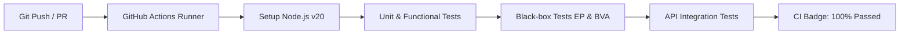

# Tugas 5 - Implementasi Pengujian Perangkat Lunak: Black-box Testing (Equivalence Partitioning & BVA)

[](https://github.com/jackyfirmansah/tugas-5-black-box-testing/actions)


Repository ini berisi penyelesaian lengkap **Latihan Terstruktur (Tugas Kuliah) Pertemuan 5** mata kuliah **Implementasi Pengujian Perangkat Lunak** mengenai pengujian kotak hitam (*Black-box Testing*): **Equivalence Partitioning (EP)** dan **Boundary Value Analysis (BVA)**.

> **Dokumen Laporan Akademik Lengkap:**  
> Silakan baca file [`LAPORAN_TUGAS_5.md`](./LAPORAN_TUGAS_5.md) untuk ulasan teoritis mendalam, analisis per field, matriks test case komprehensif, dan pembahasan studi kasus.

---

## 📋 Daftar Isi Soal & Struktur Tugas

| Bagian | Topik | Bobot | Ringkasan Pembahasan |
| :--- | :--- | :---: | :--- |
| **Bagian A** | **Equivalence Partitioning** | 30 Poin | - **Soal 1:** Form Login (Username, Password, Umur)<br>- **Soal 2:** Form Pemesanan Tiket (Jumlah Tiket, Kode Promo, Tgl Berangkat) |
| **Bagian B** | **Boundary Value Analysis** | 30 Poin | - **Soal 3:** Pendaftaran Mahasiswa (Nilai Ujian, IPK, Semester)<br>- **Soal 4:** Transfer Bank (Nominal Transfer, Biaya Admin, Batas Saldo Min) |
| **Bagian C** | **Kombinasi EP & BVA** | 25 Poin | - **Soal 5:** Form Registrasi Akun (Nama, Username, Email, Password, Umur, No HP) &rarr; **30 Test Cases** |
| **Bagian D** | **API Testing** | 15 Poin | - **Soal 6:** Endpoint `POST /api/v1/products` (Payload JSON, Validasi, Auth Token, Status 201/400/401) |
| **Bagian E** | **Studi Kasus Terpadu (Bonus)** | 10 Poin | - **Soal 7:** Form Pendaftaran Online Terpadu &rarr; **30 Test Cases** Lengkap (EP & BVA) |

---

## 🚀 Ringkasan Solusi Tugas

### Bagian A: Equivalence Partitioning
#### Soal 1: Form Login
- **Username (5-20 char, alfanumerik):**
  - Valid: `user123` (5-20 char)
  - Invalid: `usr1` (< 5), `user12345678901234567` (> 20), `user_123!` (simbol), `""` (kosong).
- **Password (min 8 char, huruf besar, kecil, angka):**
  - Valid: `Pass1234`
  - Invalid: `Pass1` (< 8), `pass1234` (tanpa huruf kapital), `PASS1234` (tanpa huruf kecil), `Passwordku` (tanpa angka).
- **Umur (17-100 tahun):**
  - Valid: `25`
  - Invalid: `10` (< 17), `150` (> 100), `"abc"` (non-numerik).

#### Soal 2: Form Pemesanan Tiket
- **Jumlah Tiket (1-10 tiket):** Valid: `1, 5, 10`. Invalid: `0`, `-1`, `11`, `"dua"`.
- **Kode Promo (5-10 char, opsional):** Valid: `"PROMO10"`, `""` (kosong). Invalid: `"DISC"` (< 5), `"DISKONBESAR100"` (> 10).
- **Tanggal Keberangkatan (YYYY-MM-DD, minimal hari ini):** Valid: Hari ini, masa depan. Invalid: masa lalu, format salah, tanggal kalender tidak eksis.

---

### Bagian B: Boundary Value Analysis
#### Soal 3: Pendaftaran Mahasiswa
- **Nilai Ujian (0-100):** $-1$ (Invalid), $0$ (Valid), $1$ (Valid), $99$ (Valid), $100$ (Valid), $101$ (Invalid).
- **IPK (0.0-4.0):** $-0.1$ (Invalid), $0.0$ (Valid), $0.1$ (Valid), $3.9$ (Valid), $4.0$ (Valid), $4.1$ (Invalid).
- **Semester (1-14):** $0$ (Invalid), $1$ (Valid), $2$ (Valid), $13$ (Valid), $14$ (Valid), $15$ (Invalid).

#### Soal 4: Form Transfer Bank
- **Nominal Transfer (Rp10.000 - Rp100.000.000):**
  - $min-1$: Rp9.999 (Invalid)
  - $min$: Rp10.000 (Valid)
  - $min+1$: Rp10.001 (Valid)
  - $max-1$: Rp99.999.999 (Valid)
  - $max$: Rp100.000.000 (Valid)
  - $max+1$: Rp100.000.001 (Invalid)
- **Batas Saldo Minimal (Admin Rp2.500, Saldo Min Rp50.000):**
  - Misal saldo awal Rp100.000: Transfer Rp47.500 (Valid, sisa tepat Rp50.000), Transfer Rp47.501 (Invalid, saldo sisa < Rp50.000).

---

### Bagian C: Kombinasi EP & BVA (Soal 5)
Menggabungkan EP dan BVA pada form registrasi akun:
- 30 test case mencakup batas panjang nama (2, 3, 4, 49, 50, 51), batasan username (diawali angka/simbol), format email, kekuatan password, batas umur (16, 17, 100, 101), dan panjang nomor HP (9, 10, 13, 14 digit serta prefix 08).

---

### Bagian D: API Testing (Soal 6)
Pengujian endpoint `POST /api/v1/products`:
1. `TC-01`: Valid Request &rarr; `201 Created`
2. `TC-02`: Name < 3 karakter &rarr; `400 Bad Request`
3. `TC-03`: Price < 1000 &rarr; `400 Bad Request`
4. `TC-04`: Stock > 1000 &rarr; `400 Bad Request`
5. `TC-05`: Category invalid &rarr; `400 Bad Request`
6. `TC-06`: Missing/Wrong Auth Token &rarr; `401 Unauthorized`
7. `TC-07`: BVA Boundary Min (Price 1000, Stock 0) &rarr; `201 Created`
8. `TC-08`: BVA Boundary Max (Price 10jt, Stock 1000) &rarr; `201 Created`

---

### Bagian E: Studi Kasus Terpadu Bonus (Soal 7)
Form Pendaftaran Online Terpadu dengan 30 test cases:
- Menangani verifikasi umur $\ge 17$ tahun secara dinamis berdasarkan kalkulasi selisih tanggal lahir (`YYYY-MM-DD`).
- Validasi password berbobot tinggi (huruf besar, kecil, angka, simbol khusus).
- Validasi kecocokan konfirmasi password.

---

## 🛠️ Menjalankan Pengujian Secara Lokal

Repositori ini menggunakan fitur bawaan Node.js Test Runner (`node --test`), tanpa memerlukan instalasi dependensi pihak ketiga yang berat.

```bash
# 1. Clone repository
git clone https://github.com/jackyfirmansah/tugas-5-black-box-testing.git
cd tugas-5-black-box-testing

# 2. Jalankan semua pengujian (131 test cases)
npm test

# 3. Jalankan pengujian unit spesifik
npm run test:unit       # Soal 1, 2, 3, 4
npm run test:blackbox   # Soal 5 dan 7 (EP & BVA)
npm run test:api        # Soal 6 (API Testing)
```

---

## 🔄 Integrasi CI/CD (GitHub Actions)

Repositori ini telah dikonfigurasi dengan pipeline CI/CD pada `.github/workflows/test.yml`. Setiap ada *commit* atau *pull request*, GitHub Actions akan secara otomatis menjalankan seluruh rangkaian pengujian.



---

## 👨‍💻 Penyusun
- **Nama:** Jacky Firmansah
- **Mata Kuliah:** Implementasi Pengujian Perangkat Lunak
- **Institusi:** STMIK Bandung
- **Kurikulum:** 2024
